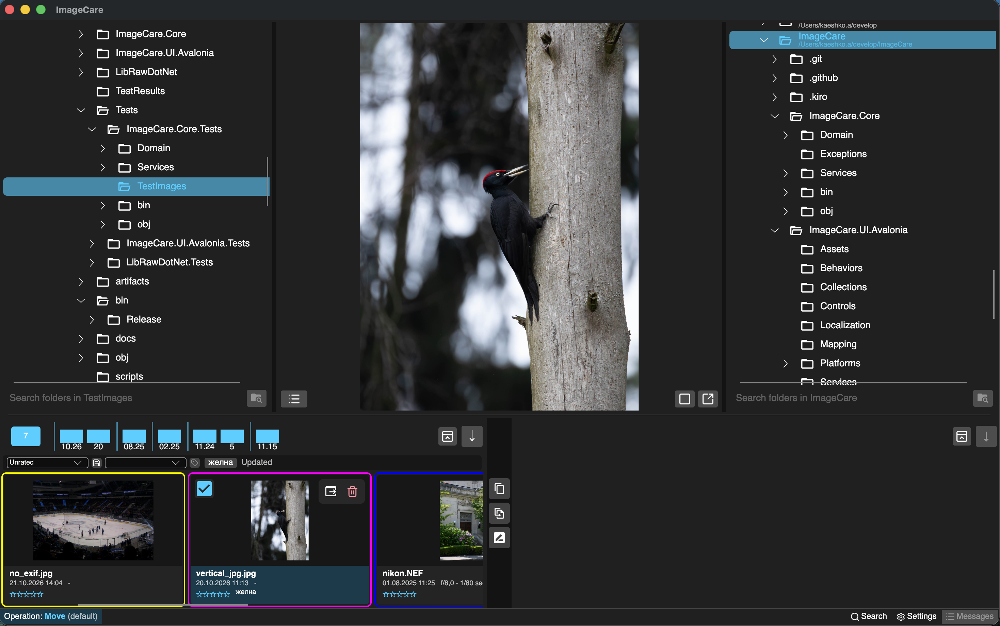

# ImageCare

[Русский](README.ru.md)

ImageCare is a desktop media manager for quickly reviewing, sorting, annotating, and moving large photo collections on Windows and macOS.

For example, a birdwatcher returns from the field with a memory card containing 6,000 images. ImageCare helps review the shoot on a timeline, rate successful frames, add tags, and move selected files into destination folders.



## Features

- Two folder panels and a shared preview strip for sorting files between directories.
- Folder overview with a timeline, adjustable grid, sorting, and restored-file list.
- Time-based image clustering marks related shooting sessions with colored frames in folders containing up to 5,000 media files.
- Preview extraction and metadata reading for JPEG, RAW images, and MP4 video.
- Ratings and tags stored in XMP sidecar files.
- Indexed search by file properties, rating, and tags.
- Configurable copy, move, delete, drag-and-drop, and external viewer actions.
- Safe deletion buffer with file restoration.
- English and Russian interface.

## Supported formats

| Type | Formats |
|---|---|
| Images | JPEG/JPG, Canon CR3, Sony ARW, Nikon NEF |
| Video | MP4 |
| Metadata sidecars | XMP |

XMP files are metadata sidecars and do not appear as media items.

## Supported platforms

Release builds target:

- Windows x64
- macOS arm64 (Apple silicon)

Linux, Windows x86, and macOS x64 are not currently release targets.

## Install a release

Download the archive for your platform from [GitHub Releases](https://github.com/ondister/ImageCare/releases), extract it, and start ImageCare. The macOS bundle is ad-hoc signed; depending on system security settings, macOS may ask you to confirm opening it.

## Build from source

### Requirements

- [.NET SDK 10.0.401](https://dotnet.microsoft.com/download/dotnet/10.0) or a compatible 10.0 patch selected by `global.json`
- macOS or Windows

### Restore, build, and run

```bash
dotnet restore ImageCare.sln
dotnet build ImageCare.sln --configuration Release --no-restore
dotnet run --project ImageCare.UI.Avalonia/ImageCare.UI.Avalonia.csproj
```

### Create platform builds

macOS arm64:

```bash
zsh scripts/publish-macos-arm64.sh
```

The app bundle is written to `artifacts/macos-arm64/ImageCare.app`.

Windows x64:

```powershell
dotnet restore ImageCare.UI.Avalonia/ImageCare.UI.Avalonia.csproj --runtime win-x64 -p:PublishReadyToRun=true
dotnet publish ImageCare.UI.Avalonia/ImageCare.UI.Avalonia.csproj --configuration Release --runtime win-x64 --self-contained true --no-restore -p:PublishReadyToRun=true --output artifacts/windows-x64/publish
```

## Main controls

| Action | Control |
|---|---|
| Copy the selected media file | `F5` |
| Move the selected media file | `F6` |
| Delete the selected media file | `Delete` |
| Create a directory in a folder panel | `F7` |
| Copy or move with drag and drop | Drag a preview to the other panel; the modifier and default operation are configurable |
| Choose the active preview folder | Select a directory in the left or right folder panel |

Before processing an important collection, verify the configured copy, move, and safe-deletion behavior on copies of several files.
